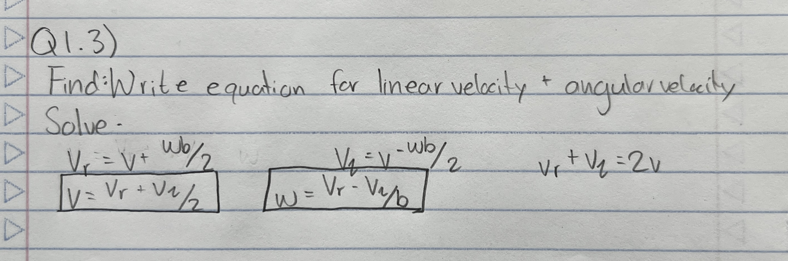
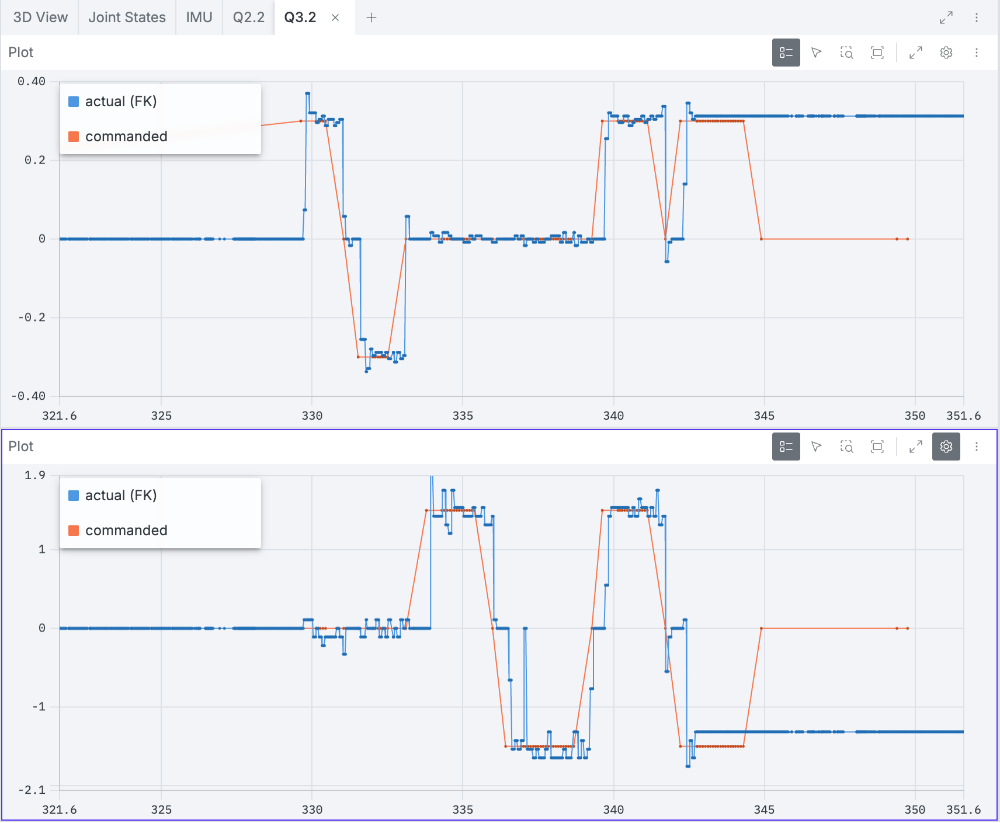
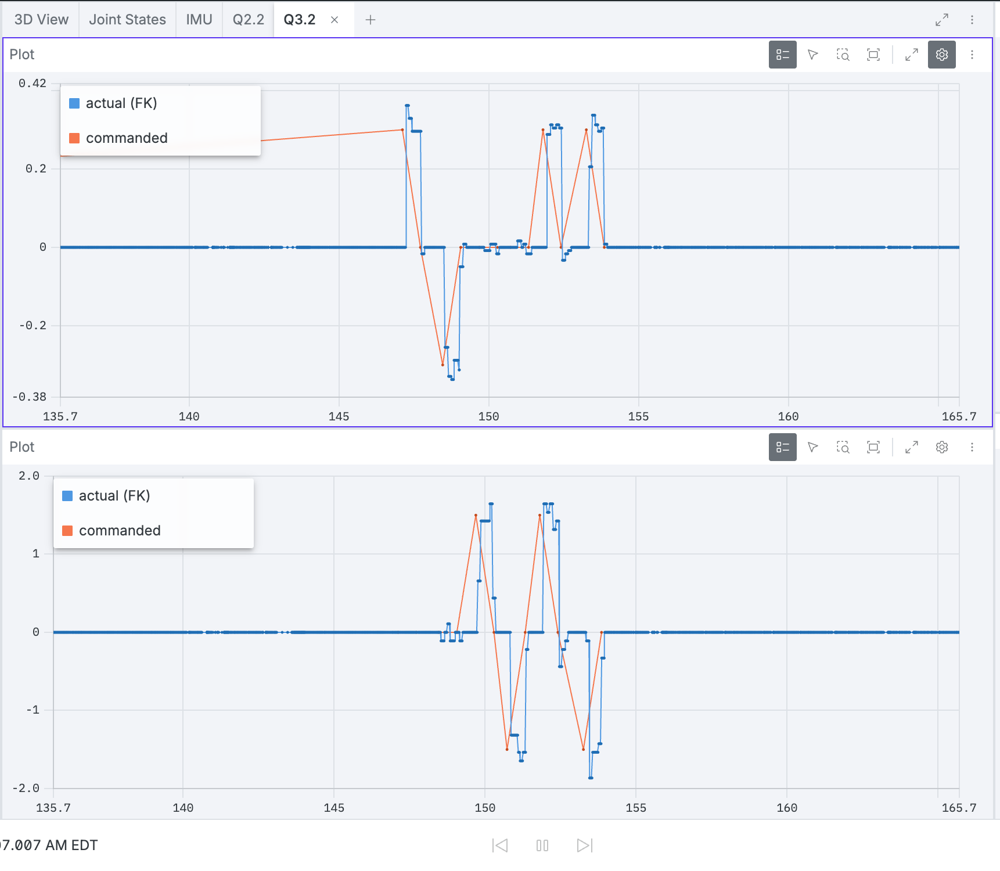

<!---
If you're new to markdown, check out this reference: https://www.markdownguide.org/basic-syntax/
-->

# Writeup

## Q0. Investigating Transforms in Foxglove (10 pts)

**Q0.1:**

Part 1: 
- The rover moves forward along the positive X axis (+X) of the base_link frame. In Foxglove, the red (X) axis of base_link points toward the front of the rover, and driving forward with teleop sends a positive linear.x command.

Part 2: 
- Both wheel_left and wheel_right rotate in the positive direction when the rover moves forward. We confirmed this by echoing `/joint_states/velocity` while driving forward with teleop: both wheel velocities were positive (and both were negative when driving backward).

## Q1. Identifying a Kinematic Model (20 pts)

**Q1.1:** 

Left Wheel Velocity Equation:
$v_L = v - \frac{\omega b}{2}$

Right Wheel Velocity Equation:
$v_R = v + \frac{\omega b}{2}$

<!---

You can use LaTeX syntax like so: $a_{example} = b_{example} + c_{example}$.
You can use $\upsilon$ for linear velocity and $\omega$ for angular velocity.

If you prefer to write out your work, you can include it in an image as follows:

-->

**Q1.2:**
Angular Velocity for Left Wheel Equation:

$\boxed{\dot{\phi}_L = \frac{2v_l}{d}}$

Angular Velocity for Right Wheel Equation:

$\boxed{\dot{\phi}_R = \frac{2v_r}{d}}$

**Q1.3:** 

Linear Velocity Equation:

$\boxed{v = \frac{v_r + v_l}{2}}$

Angular Velocity Equation:

$\boxed{\omega = \frac{v_r - v_l}{b}}$

## Q2. Inverse Kinematics (20 pts)

**Q2.2:** 

**Q2.3:** 

The predicted and actual velocities are relatively similar. The trends for both the right and left wheels show similar peaks, increases, and decreases in velocity. One of the major differences is that the predicted velocities respond earlier than the actual velocities due to delays in the physical system. When the joystick is moved, the input signal must first be transmitted via wifi to the robot's control board. The board then processes the signal and sends commands to the motors. Afterward, the measured velocity data must be transmitted back through Bluetooth and displayed graphically. These additional steps introduce delays in the actual velocity response. In contrast, the theoretical model uses the joystick input to instantly predict the robot's velocity without accounting for communication and processing delays. This explains why the predicted velocities generally respond earlier than the actual measured velocities.

Another big difference we noticed is that the actual wheel velocity seems to have a limit. When the predicted velocity goes to around -30 to -32 rad/s, the measured velocity flattens out at about -25 rad/s and doesn't go any further. This happens in both wheels, for example around 2184–2190, 2192–2197, and 2198–2204 on the graph. We think this is because the motors are reaching their maximum speed (about 25 rad/s × 0.033 m ≈ 0.8 m/s at the wheel), or because the controller limits how fast the wheels can spin. Our inverse kinematics equations don't know about this limit, so they keep predicting higher speeds than the wheels can actually reach. Other things like wheel slip, friction, and the speed controller not perfectly tracking the target speed could also cause small differences.

## Q3. Forward Kinematics (20 pts)

**Q3.2:** 

In both screenshots, the top plot compares the commanded linear velocity (orange, `/diff_drive_controller/cmd_vel.linear.x`) with the linear velocity computed from the wheel encoders by our forward kinematics node (blue, `/cmd_vel_ground_truth.twist.linear.x`). The bottom plot does the same for angular velocity (`angular.z`). The rover was driven forward, backward, and spun left and right using keyboard teleop (0.3 m/s, 1.5 rad/s).

**How do the commanded and actual velocities compare?**

Overall, the actual velocities follow the commanded velocities closely. When ±0.3 m/s was commanded, the measured linear velocity settled between about 0.29 and 0.34 m/s in magnitude. When ±1.5 rad/s was commanded, the measured angular velocity stayed roughly between 1.4 and 1.65 rad/s in magnitude. The signs always matched the command, which confirms that our forward kinematics equations and wheel sign conventions are correct. The main differences are:

- **Lag:** the actual velocity changes about 0.1–0.3 s after the command changes, both when starting and when stopping.
- **Overshoot:** the rover briefly exceeds the command when starting a motion, for example up to 0.37 m/s linear around t = 330 s in Run 1, about 0.35 m/s around t = 147 s in Run 2, and up to about 1.9 rad/s angular in both runs.
- **Noise:** the measured signals are stair-stepped and jittery instead of flat, and the angular velocity is noticeably noisier than the linear velocity.
- **Coupling:** while spinning in place, the measured linear velocity is not exactly zero (small ±0.01 m/s wobble, Run 1 at 334–339 s). While driving straight, the measured angular velocity also shows small nonzero values.
- **Missed stop (Run 1 only):** near the end of Run 1 (t ≈ 343–351 s), the command returned to zero, but the rover kept moving at about 0.31 m/s and −1.3 rad/s. In Run 2 the rover stopped correctly every time (actual returns to 0 by t ≈ 154 s and stays there).

Note: the sloped orange segments are an artifact of Foxglove connecting the sparse teleop messages with straight lines. The actual command is a step change.

**What could account for those differences?**

- **Communication and processing delay:** the command travels over WiFi to the rover, is processed by the controller, and the encoder data then has to be sent back to the computer and plotted. This adds latency between the command and the measured response.
- **Motor dynamics and inertia:** the motors cannot change the wheel speed instantly, and the wheel speed controller needs time to accelerate the rover. The brief overshoot suggests the speed controller is slightly underdamped.
- **Encoder resolution:** wheel velocity is estimated from a finite number of encoder ticks per sample, so the measured velocity jumps between discrete levels. That explains the stair-step shape and the jitter.
- **Amplification in the angular calculation:** angular velocity is computed as $\omega = \frac{v_r - v_l}{b}$ with a small wheel separation $b = 0.15$ m. Any small error in the wheel speeds gets divided by 0.15, which amplifies it about 6.7×. That is why the angular plot is noisier than the linear plot.
- **Wheel slip and motor mismatch:** when spinning in place, the wheels slip on the floor, and the two motors are not perfectly identical. This causes the small linear velocity while turning and the small angular velocity while driving straight. The forward kinematics model also assumes ideal wheels that roll without slipping and an exact wheel diameter and separation, which is never perfectly true.
- **Lost commands:** the missed stop in Run 1 is most likely a stop command that never reached the rover over the wireless link, so the rover kept executing the last command it received. This shows that the commanded velocity is not always what the rover actually does, which is why measuring the real velocity with forward kinematics is useful.

## Q4. Calculating an Odometry Solution (30 pts)

**Q4.3:** 

**Observations**

- **Experiment 1 (wheels in the air):** The rover moved in Foxglove even though it was not actually moving.
- **Experiment 2 (one wheel stopped by hand):** The rover spun in Foxglove when we held one wheel, instead of going forward as commanded.
- **Experiment 3 (driving into a wall):** The rover kept going forward in Foxglove even though it was blocked by the wall.

**Why the odometry behaves this way**

Our odometry is computed only from the wheel encoders. Forward kinematics turns the measured wheel speeds into a linear and angular velocity, and the odometry node integrates those velocities over time to estimate the pose. This assumes the wheels are always on the ground and roll without slipping. The odometry can only measure how much the wheels turned, not whether the rover actually moved.

- In Experiment 1, the wheels spun freely in the air. The encoders still measured wheel rotation, so the odometry integrated a velocity and estimated motion that never happened.
- In Experiment 2, one wheel had zero velocity while the other kept turning. From $\upsilon = \frac{\upsilon_r + \upsilon_l}{2}$ and $\omega = \frac{\upsilon_r - \upsilon_l}{b}$, this gives a small linear velocity and a large angular velocity, so the odometry predicts the rover pivoting around the stopped wheel. The odometry has no way of knowing the wheel was being held, so it does not match what was commanded.
- In Experiment 3, the rover could not move forward, but the wheels kept turning and slipped on the floor. The encoders counted that rotation, so the estimated position kept moving forward through the wall.

In all three cases the error accumulates and is never corrected, because there is no other sensor to check the wheel-based estimate against.

**Proposed improvements**

- **IMU:** The gyroscope measures the rover's actual rotation rate, which would show that the rover was not spinning in Experiments 1 and 2. The accelerometer could detect that the rover was lifted off the ground, or the sudden deceleration of hitting the wall in Experiment 3.
- **LiDAR:** Comparing consecutive laser scans (scan matching or SLAM) shows whether the surroundings are actually moving relative to the rover. In Experiment 3 the wall distance stays constant, so LiDAR would show the rover is not moving forward.
- **Sensor fusion:** Combining wheel odometry, IMU, and LiDAR with a filter such as an Extended Kalman Filter (for example the `robot_localization` ROS package) would let the other sensors correct wheel-odometry errors like slip.
- **Motor current/effort:** A large motor effort with little measured motion could be used to detect stalls or wheel slip and to stop trusting the wheel odometry during those periods.

## Feedback

**How much time did you spend on this assignment?** 

5 hours

**Do you have any feedback for this assignment?**

Sometimes, after driving the robot forward for a long time, it kept moving forward even after we tried to stop it (with both the Foxglove joystick and keyboard teleop), and it would not stop on its own. We had to unplug the robot multiple times to stop it.

## Use of AI

- Used AI in question 1 to help convert equations into LaTeX form.
- Used AI in question 2.2 to help clean up gramatical errors in my response.
